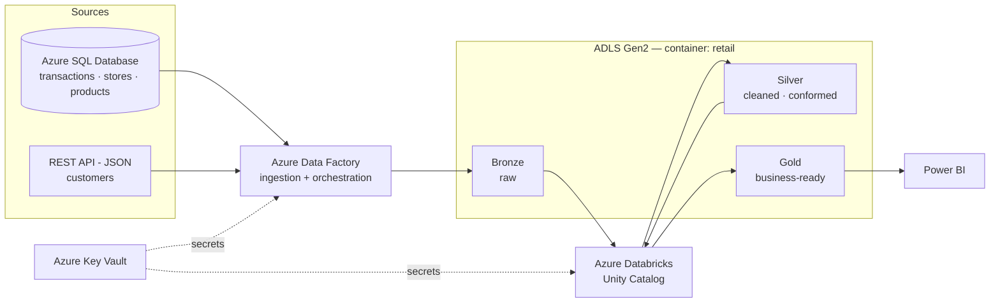

# Azure Retail Data Platform

End-to-end retail analytics platform on Azure: multi-source ingestion with **Azure Data Factory**, a **Medallion lakehouse** on **ADLS Gen2 + Azure Databricks (Unity Catalog)**, and **Power BI** reporting.

## Architecture



## Data sources

| Source | Type | Entities | Notes |
|---|---|---|---|
| Azure SQL Database | Relational | `transactions`, `stores`, `products` | Free offer (serverless, auto-pause) |
| REST API | JSON over HTTP | `customers` | Served from [`data/api/customers.json`](data/api/customers.json) |

## Medallion layers

- **Bronze** — raw copies of each source, landed by ADF (Parquet / JSON), no transformation.
- **Silver** — typed, deduplicated and standardized Delta tables (trimmed strings, normalized casing, null handling, date parsing).
- **Gold** — star schema for reporting: `fact_sales`, `dim_store`, `dim_product`, `dim_customer`, plus aggregated KPI tables.

## Business KPIs (Power BI)

- Total sales by store and category
- Daily sales trend by product
- Average order value per store
- Heatmap: store × category × sales

## Azure resources

| Resource | Name | Resource group | Region |
|---|---|---|---|
| Storage (ADLS Gen2) | `stdbxpocazed2026` — container `retail` | `rg-databricks-poc` (shared) | France Central |
| Databricks workspace | Unity Catalog enabled | `rg-databricks-poc` (shared) | France Central |
| Azure SQL server / DB | `sql-retail-azed` / `sqldb-retail` | `rg-retail-dev` | France Central |
| Data Factory | `adf-retail-azed` | `rg-retail-dev` | France Central |
| Key Vault | — | `rg-retail-dev` | France Central |

Design choice: the storage account and Databricks workspace are a **shared platform** reused across projects, while project-specific resources live in a dedicated resource group (`rg-retail-dev`) so the project can be torn down independently.

## Repository structure

```
azure-retail-data-platform/
├── data/api/          # customers.json — source for the REST API
├── sql/               # DDL + seed data for Azure SQL
├── adf/               # ADF pipelines, datasets, linked services (Git integration)
├── databricks/        # Bronze → Silver → Gold notebooks
├── powerbi/           # Report (.pbix) and screenshots
└── README.md
```

## Progress

- [x] Resource group `rg-retail-dev`
- [x] ADLS container `retail` with `landing/`, `bronze/`, `silver/`, `gold/`
- [x] Azure SQL Database (free offer) + firewall rules
- [x] Source tables created and seeded (10 products, 5 stores, 30 transactions)
- [x] Customer JSON published as HTTP source
- [ ] Azure Data Factory + Git integration
- [ ] Key Vault and linked services
- [ ] Ingestion pipelines → Bronze
- [ ] Databricks Silver transformations
- [ ] Databricks Gold star schema
- [ ] End-to-end orchestration (ADF → Databricks)
- [ ] Power BI dashboard

## Tech stack

Azure Data Factory · Azure SQL Database · ADLS Gen2 · Azure Databricks · Delta Lake · Unity Catalog · PySpark · Azure Key Vault · Power BI · GitHub
