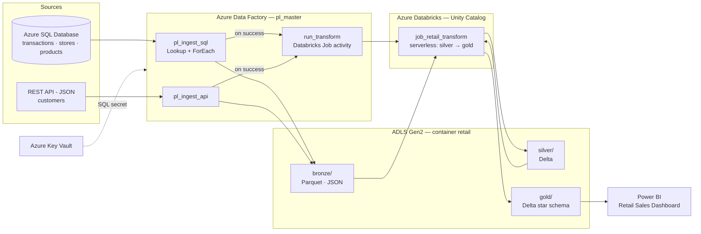

# Azure Retail Data Platform

End-to-end retail analytics platform on Azure: multi-source ingestion with **Azure Data Factory**, a **Medallion lakehouse** on **ADLS Gen2 + Azure Databricks (Unity Catalog)**, orchestrated as a single pipeline, and a **Power BI** dashboard for business users.


## Architecture



**Flow:** `pl_master` runs both ingestions in parallel. Only when both succeed does it trigger the Databricks job, which rebuilds Silver then Gold. Power BI imports the Gold star schema.

## Data sources

| Source | Type | Entities | Notes |
|---|---|---|---|
| Azure SQL Database | Relational | `transactions`, `stores`, `products` | Free offer (serverless, auto-pause) |
| REST API | JSON over HTTP | `customers` | Served from [`data/api/customers.json`](data/api/customers.json) |

## Medallion layers

| Layer | Storage | Built by | Content |
|---|---|---|---|
| **Bronze** | `retail/bronze/` — UC external volume `retail.bronze.raw` | ADF | Raw copies per source, partitioned by `ingestion_date=YYYY-MM-DD` (full history kept) |
| **Silver** | `retail/silver/` — schema `retail.silver` | Databricks | Typed, standardized, deduplicated Delta tables (latest version per business key) + quality checks |
| **Gold** | `retail/gold/` — schema `retail.gold` | Databricks | Star schema `fact_sales` + `dim_customer`, `dim_product`, `dim_store`, `dim_date`, and KPI views |

Quality gates in Silver: non-null keys, `quantity > 0`, `price >= 0`, and referential integrity checks (no orphan transactions).

## Power BI dashboard

Report built as a **Power BI Project (PBIP)** in [`powerbi/`](powerbi/) so model and report changes are reviewable in Git.

- KPIs: revenue, orders, average order value, units sold
- Revenue by store · sales share by category · store × category heatmap
- Monthly revenue trend · average order value by store
- Slicers: category and store
- Measures defined once in the semantic model (DAX), e.g. `Panier Moyen = DIVIDE([Total Ventes], [Nb Commandes])`

## Architecture decisions

| Decision | Rationale |
|---|---|
| **No secrets in code or Git** — Key Vault + managed identities | ADF reads the SQL password from Key Vault and reaches ADLS and Databricks with its system-assigned managed identity. Databricks reaches ADLS through an Access Connector (UC storage credential). |
| **Least-privilege RBAC** | ADF: *Key Vault Secrets User* (read only) and *Storage Blob Data Contributor* scoped to the storage account. Engineer: *Key Vault Secrets Officer*. |
| **Generic, metadata-driven SQL ingestion** | One pipeline (Lookup on `INFORMATION_SCHEMA` → ForEach → parameterized Copy) ingests every table; a new table needs no pipeline change. |
| **ADF orchestrates, Databricks transforms** | Scheduling lives only on `pl_master`. The Databricks job has no schedule of its own, which prevents transforms running on stale Bronze data or running twice. |
| **Databricks Job (serverless) instead of ADF Notebook activity** | No cluster to provision (no 5-min cold start, no vCPU quota issue), the job manages its own task dependencies, and it runs under an identity that already holds UC privileges. |
| **Bronze as a UC external volume; Silver/Gold as UC managed tables** | ADF writes plain files; Databricks governs everything downstream. Catalog default storage isolated in `_managed/` so it never overlaps the Bronze volume. |
| **Shared platform vs project resources** | Storage account and Databricks workspace are shared (`rg-databricks-poc`); project resources live in `rg-retail-dev` and can be torn down independently. |
| **Power BI Import mode** | Small Gold dataset, instant visuals, full DAX. The SQL warehouse can stop after refresh — DirectQuery would wake the serverless warehouse on every click. |
| **Star schema in Power BI, not KPI views** | Enables cross-filtering across visuals and correct measures (an average order value must be recomputed, never averaged from pre-aggregated rows). |
| **PBIP instead of PBIX** | Text-based model (TMDL) and report (JSON) give readable diffs and code review in Git. |

## Governance (Unity Catalog)

- Catalog `retail` with schemas `bronze`, `silver`, `gold`; lineage Bronze → Silver → Gold tracked automatically by Unity Catalog.
- BI consumers get read access to Gold only:

```sql
GRANT USE CATALOG ON CATALOG retail      TO `<bi-analyst>`;
GRANT USE SCHEMA  ON SCHEMA  retail.gold TO `<bi-analyst>`;
GRANT SELECT      ON SCHEMA  retail.gold TO `<bi-analyst>`;
```

## Cost (FinOps)

| Resource | Cost driver | Choice made |
|---|---|---|
| Azure SQL Database | Free offer | Auto-pause when the monthly free quota is reached — no overage billing possible |
| Data Factory | Per activity run | No trigger enabled in dev; debug runs only |
| Key Vault / ADLS | Per operation / GB | Negligible at this volume |
| Databricks | Serverless DBUs | Job compute only while running (~1–2 min per run), *performance optimized* mode off, SQL warehouse with short auto-stop, Power BI in Import mode |

Costs were monitored per resource group and per meter with Azure Cost Management during development.

## Known limitations & next steps

- Sales amount uses the **current catalog price** — the source has no price at time of sale.
- **Full load** on each run; next step: watermark-based incremental load (`updated_at`) and `MERGE` in Silver.
- SQL source uses SQL authentication (password in Key Vault); next step: Entra ID / managed identity authentication only.
- ADF holds the *Contributor* role on the Databricks workspace; in production, use a workspace service principal with *Can Manage Run* on the job only.
- Infrastructure created through the portal; next step: Terraform for all resources and CI/CD (ADF ARM templates from `adf_publish`, Databricks Asset Bundles).
- Daily trigger on `pl_master` to enable once in production.

## Repository structure

```
azure-retail-data-platform/
├── adf/                    # ADF pipelines, datasets, linked services (Git integration)
├── data/api/               # customers.json — source served as REST API
├── databricks/             # 00_setup_unity_catalog, 01_silver, 02_gold
├── powerbi/                # Retail_Sales_Dashboard (PBIP) + dashboard.png
├── sql/                    # DDL + seed data for Azure SQL
└── README.md
```

## Progress

- [x] Azure SQL Database (free offer) seeded with source tables
- [x] Customer JSON published as HTTP source
- [x] Azure Data Factory with Git integration
- [x] Key Vault, managed identities and least-privilege RBAC
- [x] Generic ingestion pipelines → Bronze
- [x] Unity Catalog setup (external location, catalog, schemas, volume)
- [x] Silver transformations with quality checks
- [x] Gold star schema and KPI views
- [x] End-to-end orchestration (`pl_master` → Databricks job)
- [x] Power BI dashboard (PBIP)
- [ ] Terraform + CI/CD
- [ ] Incremental loading

## Tech stack

Azure Data Factory · Azure SQL Database · ADLS Gen2 · Azure Databricks · Delta Lake · Unity Catalog · Databricks Jobs (serverless) · Azure Key Vault · Power BI (PBIP, DAX) · GitHub
